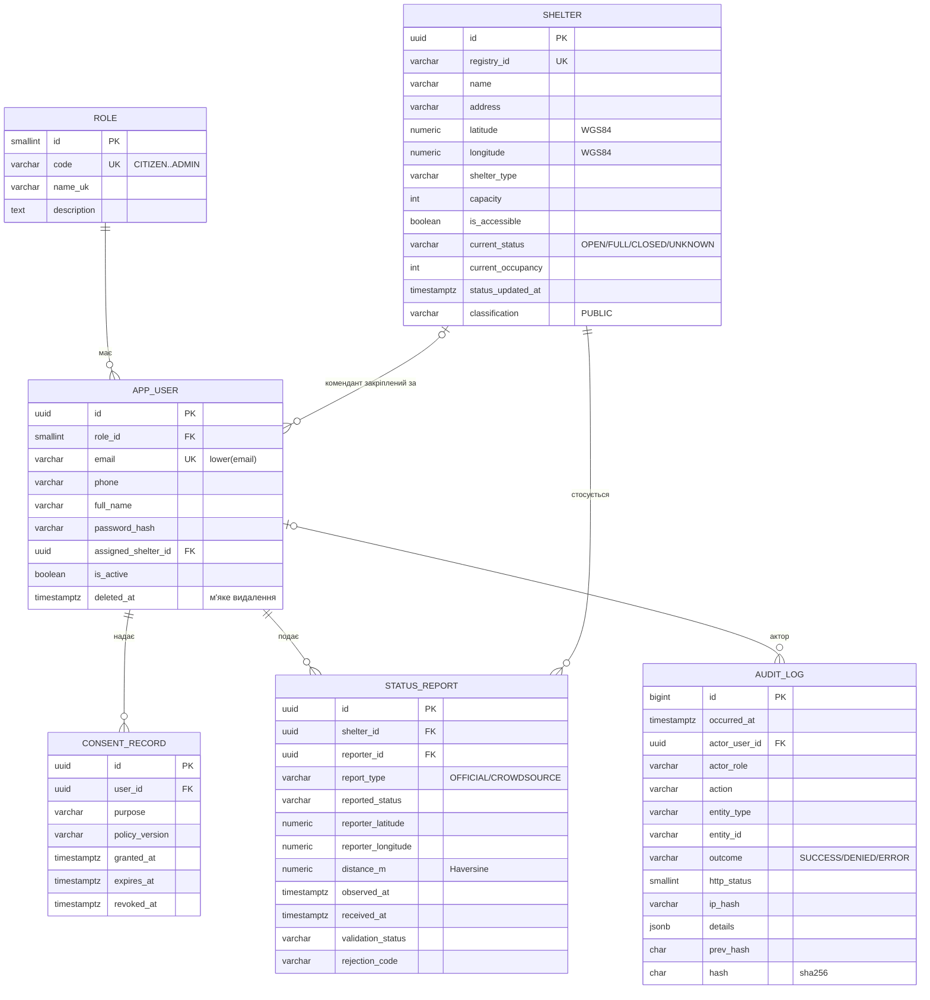

# Схема бази даних SkyGuard

Міграція: `migrations/versions/0001_initial_schema.py`. СУБД: PostgreSQL 16.

> **Звірити з SG-2.** Коди 6 ролей і відповідність таблиць рівням класифікації взято з формулювань задач SG-1, SG-2 і SG-21. Якщо в документі Data Governance назви інші — потрібна лише правка довідника `RoleCode` / `DataClassification` і засіву ролей у міграції.

## ER-діаграма

## Таблиці

### `role` — ролі RBAC
Засіваються міграцією, 6 записів:

| id | code | Роль | Основні дозволи |
|---|---|---|---|
| 1 | `CITIZEN` | Громадянин | Мапа укриттів, краудсорс-звіт (за наявності згоди) |
| 2 | `COMMANDANT` | Комендант укриття | Офіційний статус **лише свого** укриття (`assigned_shelter_id`) |
| 3 | `MUNICIPAL_OPERATOR` | Оператор міськради | Ведення реєстру укриттів |
| 4 | `EMERGENCY_SERVICE` | Екстрена служба (ДСНС) | Статуси в реальному часі, SOS-режим |
| 5 | `AUDITOR` | Аудитор | Лише читання журналу аудиту |
| 6 | `ADMIN` | Адміністратор | Користувачі та ролі; **не** має доступу на зміну аудиту |

### `app_user` — користувачі
Назва `app_user`, бо `user` — зарезервоване слово PostgreSQL. Одна роль на користувача. Email унікальний без урахування регістру. Видалення лише м'яке (`deleted_at`) з подальшою анонімізацією полів ПДн: жорстке видалення заблоковане зовнішнім ключем з журналу аудиту.

### `shelter` — укриття
Публічні дані реєстру. `current_status` / `current_occupancy` — денормалізований останній прийнятий звіт, щоб мапа читала одну таблицю. Для споживачів віддається як GeoJSON `Feature` (геометрія `Point` з `longitude, latitude`). `registry_synced_at` — штатний режим, синхронізація раз на 24 год.

### `consent_record` — згоди на обробку ПДн
Цілі: `GEOLOCATION`, `PUSH_NOTIFICATIONS`, `CROWDSOURCE_REPORTING`. Записи не редагуються по суті: відкликання заповнює `revoked_at`, повторна згода — новий запис. Частковий унікальний індекс гарантує **не більше однієї активної згоди** на ціль. `policy_version` фіксує, на яку редакцію політики погодився користувач.

### `status_report` — звіти про статус
Офіційні (комендант) і краудсорс (громадянин). Зберігаються **всі** звіти, зокрема відхилені — для аналізу якості даних. Рядкове значення `rejection_code` повертається клієнту в тілі відповіді `422`.

### `audit_log` — незмінний журнал аудиту
Кожна значуща дія, включно з кожною відмовою `403` (`outcome = DENIED`). IP зберігається лише як хеш. `id`, `prev_hash`, `hash` присвоює тригер.

## Гарантії на рівні БД

| Правило | Як забезпечено |
|---|---|
| **DQ-1** радіус ≤ 100 м | `ck_status_report_dq1_accepted_within_radius`: `ACCEPTED` ⇒ `distance_m ≤ 100` |
| **DQ-2** свіжість ≤ 30 хв | `ck_status_report_dq2_accepted_fresh`: `ACCEPTED` ⇒ `received_at − observed_at ≤ 30 хв` |
| **DQ-3** кворум | Статус `QUORUM_PENDING`; логіку підрахунку реалізує API (SG-21), індекс `(shelter_id, received_at DESC)` |
| Відхилений звіт має причину | `ck_status_report_rejection_code_iff_rejected` |
| Звіт не з майбутнього | `observed_at ≤ received_at + 1 хв` |
| Коректні координати | CHECK на діапазони широти і довготи |
| Одна активна згода на ціль | Частковий унікальний індекс `uq_consent_active_per_purpose` |
| Аудит лише на додавання | Тригери `trg_audit_log_no_modify`, `trg_audit_log_no_truncate` |
| Виявлення підробки аудиту | Хеш-ланцюжок sha256, `SELECT audit_log_verify()` → `NULL` або id першого пошкодженого запису |

## Класифікація даних по таблицях

| Таблиця | Рівень | Обґрунтування |
|---|---|---|
| `shelter` | PUBLIC | Відкритий реєстр, потрібен усім для безпеки |
| `role` | INTERNAL | Службова довідкова інформація |
| `app_user` | CONFIDENTIAL | ПДн: email, телефон, ім'я |
| `consent_record` | CONFIDENTIAL | Пов'язана з особою юридично значуща інформація |
| `status_report` | CONFIDENTIAL | Містить геопозицію особи на момент звіту |
| `audit_log` | RESTRICTED | Безпекові події, доступ лише `AUDITOR` |

## Індекси під основні запити

| Запит | Індекс |
|---|---|
| Укриття в межах вікна мапи | `ix_shelter_lat_lon (latitude, longitude)` |
| Фільтр «лише відкриті» | `ix_shelter_status` |
| Останні звіти по укриттю, кворум | `ix_status_report_shelter_received (shelter_id, received_at DESC)` |
| Консоль аудитора: за часом / актором / об'єктом / відмовами | `ix_audit_log_occurred_at`, `ix_audit_log_actor`, `ix_audit_log_entity`, `ix_audit_log_outcome` |
